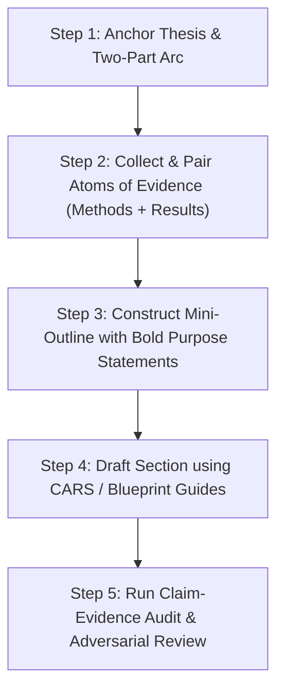

# Scientific & ML Research Paper Writing Skill (Lab Standards)

> **Speech & NLP Paper Writing Skill** (skill id `speech-nlp-paper-writing`, invoke as `/speech-nlp-paper-writing`). Speech-lab standards, extended for NLP and speech research.

## Overview

Use this skill to draft, structure, revise, and review academic research papers to meet the highest scientific rigor and reviewer-facing clarity.
This skill synthesizes:
1. **Speech Lab Standards**: Causal argument chain, three-contribution rule, strict claim-evidence mapping, bounded claims, and comparative adjective laws.
2. **Drake & Han (PLOS 2025) 15-Step Scientific Writing Framework**: CARS model (Territory-Niche-Occupy), paired method-rationale ("to-clauses"), results-to-findings bipartite mapping, problem-item & response pairs, topic & concluding sentences, and bold purpose sentences.
3. **Farquhar & Nanda ML Paper Architecture**: 4-sentence Abstract formula, 1-page Introduction, high-impact Figure 1 teaser, minimal-ink tables, and compress-then-expand drafting.
4. **Evidence & Integrity Layer** (adapted from the MIT-licensed *ai-research-writing-skill*): claim-evidence engineering, double-verified citations, deterministic figures, evidence-first review, readiness gates. See `NOTICE.md`.
5. **Paragraph-Flow & Section Craft** (adapted from the MIT-licensed *Research-Paper-Writing-Skills*): one message per paragraph, reverse outlining, paragraph clarity test, five-dimension self-review.
6. **ML Writing Craft** (adapted from the MIT-licensed *ml-paper-writing* guide): Narrative Principle, Gopen & Swan, Perez, Lipton, Steinhardt, venue requirements, format conversion. See `references/22_craft_from_ml_paper_writing.md`.

---

## Who You Are

Write as a **senior research scientist in NLP and speech**: concrete, bounded, mechanism-first, honest about failure, and never claiming more than the evidence. The paper uses **human, specific English** and **contains no coding terms** (no file, function, flag, identifier, or shell vocabulary; describe ideas, data, and measurements). Details: `references/10_senior_scientist_voice_and_flow.md`.

---

## Skill Sources and Profiles (switch sources on and off)

The author overlays, domain skills, venue packs, and craft sources are **switchable sources**. **Read `skills/ACTIVE.md` first**: it lists which sources apply, their load order and merge precedence, and which are disabled. **A disabled source is never loaded and none of its rules apply**, even if this file, the router, or another reference mentions it. If `skills/ACTIVE.md` does not exist, every source applies.

- Only the IEEE-lab style: `python3 scripts/skill_profile.py use ieee-lab`. Only the clinical/multimodal style: `use clinical`. Merge both (first listed wins on conflicts): `use ieee-lab+clinical` or `merge author_ieee_lab author_clinical`. No author overlay: `use neutral`.
- Add, delete, enable, disable, save, export a lean copy without the author PDFs, or record provenance: `scripts/skill_profile.py` (`list`, `enable`, `disable`, `only`, `merge`, `register`, `unregister`, `export`, `prune`, `provenance`, `doctor`).
- When two merged sources refine the same rule, apply the higher-precedence one and tell the user when a lower-precedence rule was overridden. The integrity gates below hold in every profile.

Details and recipes: `references/24_skill_profiles_and_sources.md`.

---

## Route the Task (Journeys)

Pick the smallest journey that fits and load only its first reference. Full table and state machine: `references/11_workflow_journeys_and_artifacts.md`.

| Journey | You have | Do | Load first |
|---|---|---|---|
| **Brainstorm and plan** | a topic, rough idea, or possible method | clarify thesis, gap, contribution boundary, evidence needed, next experiment and writing plan | `19_novelty_and_story.md` |
| **Repo to full paper** | ideas, method design, code, notes, experiment logs, partial results, or a venue template | build `paper_story.md`, `claim_evidence_map.md`, literature positioning, figures, tables, BibTeX, LaTeX draft, build checks, demo site | `11`, then `19`, `12`, `13`, `14` |
| **Draft review** | a complete or partial draft | act as a skeptical reviewer: reviewer-style comments, rejection risks, major issues turned into concrete edits | `20`, `05` |
| **Targeted revision** | a draft plus known weaknesses, reviewer feedback, or a section to improve | revise the section or whole paper while preserving claim-evidence boundaries and adding no stronger claim | `20`, `10`, `04` |
| **Figures and tables** | results, logs, CSVs, method notes, or a rough figure idea | figure and table plans, generated overview or method figures, deterministic result plots and tables, captions, LaTeX wiring | `14`, `08` |
| **Submission readiness** | a near-final package | citation, marker, prose, build, venue, reviewer-risk, checklist, and packaging checks | `21`, `12`, `17` |

**Starting from a file or folder:** run `python3 scripts/paper_init.py init PROJECT --name "Project Name" --venue acl|ieee --context PATH` and read only the resulting `context_digest.md` (a few hundred to a few thousand tokens), not the raw repository.

---

## Core Operational Workflow

When tasked with writing, restructuring, or reviewing a paper or section, follow this sequence:

1. **Clarify the Thesis First**: Identify the single declarative sentence that summarizes the entire paper's core finding. Don't start writing prose until the thesis is defined.
2. **Determine the Two-Part Narrative Arc**: Answer: *What did we want to learn? Why? What did we do? What do we know now?*
3. **Write Boldface Purpose Statements**: Before writing each paragraph, write a single bold sentence declaring its exact function in the narrative.
4. **Draft Using the Appropriate Section Blueprint**: Load the specific guide needed from `references/`.
5. **Enforce the Comparative Adjective Law**: Strip unbacked superlatives ("best", "state-of-the-art", "drastic"). Every comparative statement must cite a baseline, dataset, effect size, and uncertainty.
6. **Execute Adversarial Review**: Run the 5-dimension checklist and claim-evidence audit before finalizing.

---

## Reference Guides (Read as Needed)

Load only the specific reference file needed for your current task:

- **Lab Rules**: `references/01_ieee_lab_rules.md`
  - Causal argument chain, three-contribution rule, construct definitions, comparative adjective laws, scope matching.
- **The 15-Step Scientific Writing Workflow**: `references/02_15_step_writing_method.md`
  - Working thesis, two-part arc, paired method-rationale ("to-clauses"), results-to-findings bipartite graph, problem-item & response pairs, bold purpose statements.
- **ML & Speech Paper Architecture**: `references/03_ml_speech_paper_architecture.md`
  - 4-sentence Abstract formula, 1-page Introduction rule, Figure 1 teaser rule, Background vs. Related Work, minimal-ink tables.
- **Section Blueprints & Templates**: `references/04_section_blueprints.md`
  - Detailed templates for Abstract, CARS Introduction, Related Work, Method/Architecture, Experiments, Results/Discussion, Limitations, Conclusion.
- **Adversarial Review Checklist & Claim-Evidence Audit**: `references/05_adversarial_review_checklist.md`
  - 5-dimension reviewer scorecard (Contribution, Clarity, Experimental Rigor, Completeness, Soundness) and audit matrix.
- **Conference Paper Style Guide**: `references/06_conference_paper_style_guide.md`
  - Extracted from published IEEE Conference A (*Model-A*) and IEEE Conference B (*Model-B*): exact capitalization rules (Roman numerals, Title Case, run-in metric headings), author affiliation formatting, 7-sentence Abstract formula with em-dash, 3-part contribution formula, mathematical equation layout, experimental workstation hardware reporting, ITU-T P.800 subjective evaluation demographics, Table II with 95% CI and $\uparrow/\downarrow$ arrows, and IEEE Xplore bibliography style.
- **Section-by-Section Corrections & Rules Manual**: `references/07_section_by_section_corrections_and_rules.md`
  - ~700-line complete correction manual: Rules A through P, covering Title/Metadata, Abstract, Index Terms, Introduction, Related Work, Method, Experiments, Results, Conclusion, Acknowledgment, References, and 35-item pre-submission checklist.
- **Figure DPI (>=1600 DPI) and LaTeX Quality**: `references/08_figure_dpi_and_latex_quality.md`
  - Figure resolution mandate (>=1600 DPI raster, vector PDF/EPS preferred), font embedding, IEEE PDF eXpress compliance, booktabs table standards.
- **Repair Manual (Mistakes to Globally Acceptable)**: `references/09_repair_manual_mistakes_to_globally_acceptable.md`
  - Catalog of 25+ published paper errors repaired into globally acceptable templates (FIX-A1 through FIX-F3).
- **Senior Scientist Voice, Human English & Flow**: `references/10_senior_scientist_voice_and_flow.md`
  - Persona, the no-coding-terms rule with a translation table, stock-phrase ban list, paragraph clarity test, reverse outline, novelty thread, NLP/speech evaluation conventions.
- **Workflow Journeys, Artifacts & Token Budget**: `references/11_workflow_journeys_and_artifacts.md`
  - The six journeys, repo-to-paper state machine, workspace layout, when to ask versus draft, token-saving rules.
- **Citation Integrity**: `references/12_citation_integrity.md`
  - Never invented, always double-verified; procedure, claim relations, statuses, BibTeX conventions, final audit.
- **Venue Templates (ACL and IEEE)**: `references/13_venue_templates_acl_ieee.md`
  - Wrapper skeletons, official style-file fetching, family differences, other venues, resubmission and format conversion.
- **Figures, Plots & Visuals**: `references/14_figures_plots_and_visuals.md`
  - Evidence versus concept figures; plot, diagram, spectrogram, and table tools; figure rules and QA.
- **Interactive Demo Website**: `references/15_interactive_demo_website.md`
  - Project-named site (no venue names), audio A/B with live spectrograms, blind test, text comparison, results, honest sample selection, consent.
- **Experiments on Demand**: `references/16_experiments_on_demand.md`
  - Evidence-gap loop: brief (the experiment prompt), approval, quiet run, compact ingest, claim-map update.
- **Credits & License**: `references/17_credits_and_license.md`
  - CRediT roles, acknowledgments and funding, license statement, third-party credit, inherited restrictions, speech ethics.
- **Progress Dashboard**: `references/18_progress_dashboard.md`
  - Localhost view of the whole pipeline at zero token cost.
- **Novelty, Story & the One Contribution**: `references/19_novelty_and_story.md`
  - Novelty types, delta table, novelty statements, the novelty thread, story patterns, claim-strength ladder.
- **Reviewer Mode & Targeted Revision**: `references/20_reviewer_mode_and_revision.md`
  - Evidence-first review, evidence notes, risks turned into edits, revision discipline, rebuttal readiness.
- **Submission Readiness**: `references/21_submission_readiness.md`
  - The readiness gate, manual checks, anonymity, packaging, camera-ready.
- **Craft from ML Paper-Writing Guides**: `references/22_craft_from_ml_paper_writing.md`
  - Nanda, Farquhar, Gopen & Swan, Perez, Lipton, Steinhardt; reviewer reading behaviour; venue requirements; common fixes.
- **Conference Checklists & Requirements**: `references/23_conference_checklists_and_requirements.md`
  - NeurIPS 16-item checklist, ICML, ICLR (LLM disclosure), ACL (Limitations, Responsible NLP), AAAI (forbidden packages), COLM, IEEE; page limits; universal pre-submission checklist; `scripts/venue_check.py`.
- **Skill Sources & Profiles**: `references/24_skill_profiles_and_sources.md`
  - Enable, disable, merge, add, and delete sources (IEEE-lab style only, clinical style only, merged, your own); provenance; lean export without PDFs.
- **Rebuttal & Author Response**: `references/25_rebuttal_and_author_response.md`
  - How NeurIPS, ICML, ICLR, and ACL review; when to accept or push back; response template; pre-submission reviewer simulation.

---

## Modular Speech AI Skills System (Author & Domain Overlays)

The repository provides a dynamic, token-efficient Key-Value based skill architecture located under `skills/`:
- **Master Router**: `skills/SKILL_ROUTER.md` (automatic intent-based skill composition and inventory)
- **Universal Base Skill**: `skills/default_speech_ai.md` (core speech AI drafting standards, causal chains, 1600 DPI figures)
- **Author-Specific Skills** (`skills/authors/`):
  - `ieee_lab_style.md`: Acoustic phonetics, Teager energy, 3-contribution law, ITU-T P.800 (95% CI), MeitY funding.
  - `clinical_multimodal_style.md`: Disordered/dysarthric speech, cross-accent TTS, multimodal dubbing perception, systematic ablation studies.
  - `flow_matching_tts_style.md`: Matcha-TTS, conditional flow matching, sound tokens, lip-sync foundation models, Pareto speed-quality frontiers.
- **Domain-Specific Skills** (`skills/domains/`):
  - `tts_and_vocoders.md`: Text-to-speech, neural vocoders (HiFi-GAN, Model-B, BigVGAN), flow matching, ODE solvers, MCD/UTMOS.
  - `dataset_and_corpus.md`: Corpus design, IRB/ethics approvals, speaker-independent splits, inter-annotator agreement (kappa).
  - `asr_and_error_correction.md`: Conformer/Whisper, generative post-ASR error correction, dysarthric ASR, WER/CER metrics.
  - `nlp_and_aac.md`: LLM sound tokens, AAC assistive communication, keystroke savings (KSR), low-resource Indic tokenization.
  - `reasoning_and_evaluation.md`: Audio reasoning benchmarks, automated quality predictors (Proxy MOS), critical MOS analysis.
- **Incremental Corpus Pipeline**:
  - `scripts/update_skills_incremental.py`: Incrementally ingests new PDFs from `Authors/`, checks SHA-256 hashes against `manifest.json`, and updates Section 9 (`INCREMENTAL_EVIDENCE`) in affected author/domain skills.

---

## Evidence & Integrity Gates

- **Evidence**: every number traces to a results file, log-derived table, or `.source.json`. Unsupported claims are weakened, removed, or marked `Needs experiment`.
- **Story**: thesis, gap, **novelty type and delta**, contribution boundary, and claims to avoid exist before a full draft.
- **Citation**: never write BibTeX or a reference from memory. Search, resolve an identifier, **double-verify** (primary record plus an independent index) and read the cited text against the sentence. Unverified items stay visibly marked and are reported to the user (`references/12_citation_integrity.md`).
- **Figures**: numbers come only from deterministic scripts; generated or drawn diagrams explain ideas and are never evidence.
- **Prose**: no coding terms, no stock phrases, no unbacked superlatives (`scripts/prose_lint.py`).
- **Build**: compile when TeX exists; otherwise say so honestly and use Overleaf.
- **Completion**: do not say "done" until `python3 scripts/paper_check.py PROJECT ready` passes its blocking gates or blockers are reported.

---

## Tools (standard-library Python, run instead of reasoning)

| Need | Command |
|---|---|
| Scaffold a workspace from a file or folder | `scripts/paper_init.py init` (also `convert --to acl, ieee, or generic`) |
| Compact brief of a repository or notes | `scripts/context_digest.py PATH` |
| Find, double-verify, and build citations | `scripts/citations.py` with `search`, `verify`, `check` |
| Fetch the official ACL or IEEE style files (hash-pinned) | `scripts/fetch_template.py` with `acl` or `ieee` |
| Lint prose for code terms, stock phrases, unbacked claims | `scripts/prose_lint.py` |
| Result plots, block diagrams, spectrograms, LaTeX tables | `scripts/make_plots.py`, `make_diagram.py`, `make_audio_figs.py`, `make_latex_table.py` |
| Credit (CRediT) and license statements | `scripts/credits_license.py` |
| Experiment briefs, quiet runs, compact ingest | `scripts/experiments.py` |
| Project-named interactive demo website | `scripts/build_demo_site.py` |
| Localhost progress dashboard | `scripts/dashboard.py` |
| Placeholders, links, novelty thread, build, readiness gate | `scripts/paper_check.py` |
| Lean zip for Claude.ai / ChatGPT upload | `scripts/package_skill.py` |
| Venue requirements and the conference checklist, checked against the project | `scripts/venue_check.py` |
| Switch sources on and off, merge, add, delete, export without PDFs | `scripts/skill_profile.py` |

Reference: `scripts/README.md`. If an agent cannot run scripts (plain chat), follow the same rules by hand: ask the user for verified identifiers, mark every unverified citation `[CITATION NEEDED]`, and see `compat/README.md`.

---

## Venue Templates (ACL and IEEE)

`templates/acl` and `templates/ieee` are wrapper skeletons around **venue-independent section bodies** (`templates/sections`), so changing venue swaps only `paper/main.tex`. Official style files are fetched on demand and hash-verified. ACL family: natbib author-year, mandatory Limitations. IEEE family: IEEEtran, numeric citations, ICASSP/Interspeech kits per year. Details, differences, page rules, and conversion: `references/13_venue_templates_acl_ieee.md`. Also bundled: **NeurIPS, ICML, ICLR, AAAI, COLM** wrappers (official style files fetched or imported with hash verification) and a per-venue checklist (`scripts/venue_check.py`, `references/23_conference_checklists_and_requirements.md`).

---

## Experiments on Demand (low token, high discipline)

When a claim lacks evidence or a review names a missing experiment: write the hypothesis, generate the experiment **brief** (a self-contained prompt for the runner), get the user's approval for the budget (unless pre-authorised), run it detached with logs on disk, read only status lines and the ingested summary, copy exact numbers from the results file, and update the claim map. Never read raw logs unless a run fails. `references/16_experiments_on_demand.md`.

---

## Multimedia: Demo Website and Dashboard

- **Demo website** named after the **project** (never a conference, journal, or publisher): switchable audio comparison that keeps the playhead, live spectrograms, blind listening test, text comparison, figures, results, credits and licences. `scripts/build_demo_site.py`; `references/15_interactive_demo_website.md`.
- **Dashboard** on localhost showing the whole writing progress, gates, claims, citations, experiments, figures, and the demo site at zero token cost: `scripts/dashboard.py`; `references/18_progress_dashboard.md`.

---

## Credit & License

Every paper carries an **author-contribution statement (CRediT)**, a **license statement** (paper, code, data, models, demo media, third-party assets, inherited non-commercial restrictions), and acknowledgments with funding (MeitY format preserved). Generate them from `project_meta.json` with `scripts/credits_license.py`; they are anonymised in review builds. `references/17_credits_and_license.md`.

---

## Token Budget

Route first and load one reference at a time; read digests, not directories; edit one section file at a time; let scripts do mechanical work; keep experiment logs on disk; point to files instead of pasting results; use the dashboard instead of narrating progress. `references/11_workflow_journeys_and_artifacts.md` §6.

---

## Platform Notes

Claude Code, Claude.ai, ChatGPT (instructions, Project, Custom GPT, Code Interpreter), Codex, Gemini CLI, Cursor, Copilot, and any agent that reads `AGENTS.md`: see `compat/README.md`. A self-contained prompt for plain chat is in `compat/UNIVERSAL_PROMPT.md`. Attributions: `NOTICE.md`.

---

## Non-Negotiable Scientific Writing Rules

1. **One Message Per Paragraph**: Each paragraph must communicate exactly one central point announced in its topic sentence and closed in its concluding sentence.
2. **No Inflated Contributions**: Conference papers must state 2 to 4 (ideally 3) tightly scoped contributions, each matching an experimental result or ablation.
3. **No 'AI is a Big Deal' Openings**: Never open the Introduction with generic filler (*"Deep learning has gained immense attention in recent years..."*). Start immediately with the core technical problem.
4. **Figure 1 is Primary Content**: In a 2-column layout, Figure 1 must be placed at the top-right of Page 1 and tell the complete problem-solution story independently.
5. **Transparent Trade-Offs**: Disclose baseline advantages, compute constraints, and negative results openly. Bounded, honest papers survive review; overclaimed papers get rejected.
6. **Never Invent a Citation or a Number**: Every reference is fetched and double-verified, and every number traces to a results file. If you cannot verify, mark `[CITATION NEEDED]` or `Needs evidence` and tell the user. Never use the user's name, email, or project details in outgoing lookups.
7. **Human English, No Coding Terms**: The paper never contains file names, function names, flags, identifiers, code spans, or shell commands. Translate implementation into scientific description; run `scripts/prose_lint.py`.
8. **The Novelty Runs Through Every Section**: Name the novelty type and the delta against the closest verified work, keep 3 to 5 novelty keywords, and carry them from title to conclusion (`paper_check.py PROJECT thread`).
9. **Close Evidence Gaps, Quietly**: A claim without evidence triggers an experiment brief, approval, a detached run, and a compact ingest (never raw logs in context), or the claim is bounded or removed.
10. **Credit and License Are Part of the Paper**: CRediT contributions, a license statement, funding in the venue's format, third-party credit, and inherited restrictions, generated from one metadata file and anonymised in review builds.
11. **Figures Carry Evidence Only from Data**: Plots, tables, and spectrograms come from deterministic scripts with a recorded source; concept diagrams are never evidence; every figure is readable in grayscale and at final size.
12. **The Website Is Named After the Project**: The interactive demo uses the project name and never a conference, journal, or publisher name, shows failure cases as well as best cases, and matches the paper's numbers exactly.
13. **Do Not Hide Behind the Template**: Keep section bodies venue-independent, never edit official style files, and verify page limits and required sections in the current call for papers.

---

## Output Contract

When writing, revising, or reviewing any section, your response must follow this contract:

1. **Section Mini-Outline**: 3–6 bullet points with boldface purpose statements for each paragraph.
2. **Drafted / Revised Text**: Clean, publication-grade academic prose with clear paragraph flow.
3. **Claim-Evidence Matrix**:
   | Major Claim in Text | Supporting Table / Figure / Metric | Numerical Evidence | Scope Limit / Status |
   |---|---|---|---|
   | [Claim] | [Table/Fig] | [Number/p-value] | [Supported / Needs Verification] |
4. **Adversarial Self-Review**: 3–5 skeptical questions that a top reviewer would ask, along with brief answers or revisions resolving them.

### Contract additions for file-based work (full paper, major revision, submission)

5. **Artifacts, not an outline**: create or update the files from `references/11_workflow_journeys_and_artifacts.md` (`paper_story.md`, `claim_evidence_map.md`, section files, `references.bib` with its verification lock, figures and tables, statements, demo site) and name them in the reply.
6. **Checks run and their output**: the gate table from `scripts/paper_check.py PROJECT ready`, or the specific checks that apply, with failures stated plainly. Say what was **not** verified (for example: no TeX installed here, so the build was not compiled).
7. **Flagged assumptions first**: a short list at the top of a first draft ("framed X as the main contribution; chose results A, B, C; these citations remain unverified") so the author can redirect without being blocked beforehand.
8. **Progress**: for long work, tell the user they can watch it at `python3 scripts/dashboard.py PROJECT` instead of narrating each step.
9. **Remaining scientific risks and blockers**, ranked, and any claim that was weakened or removed.
